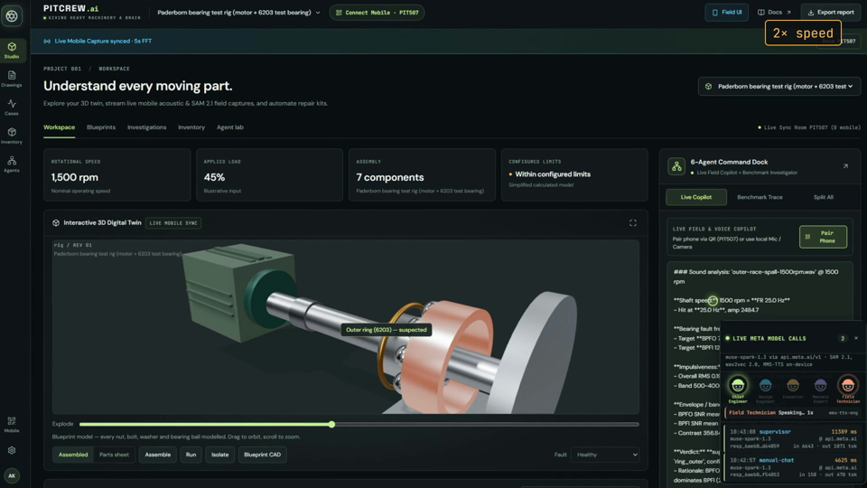
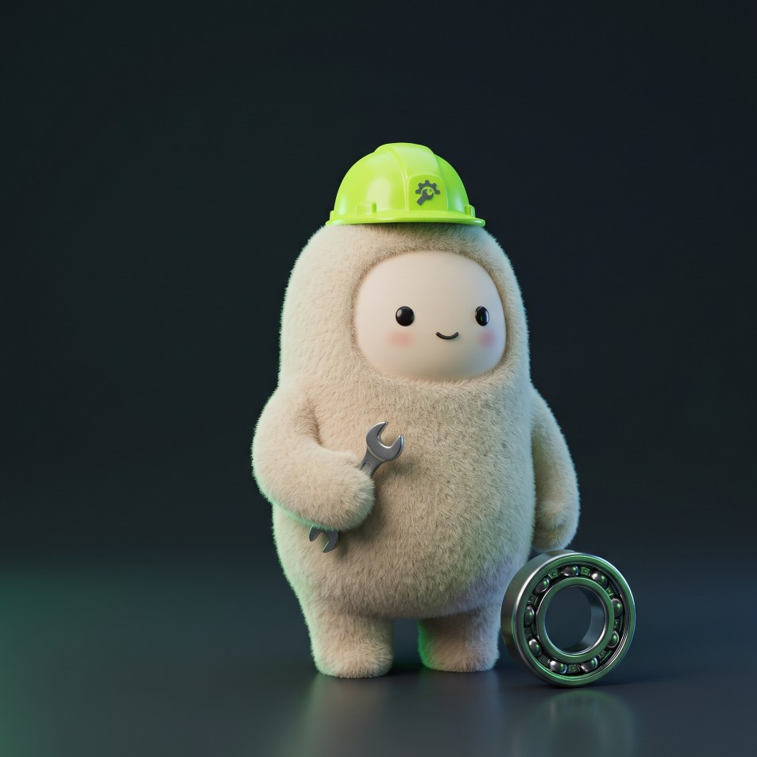
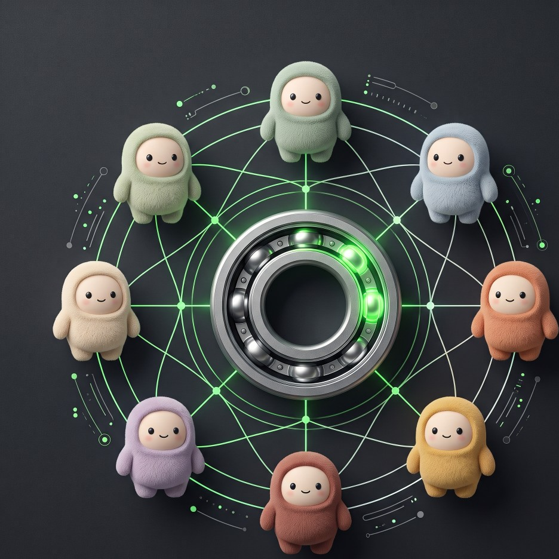
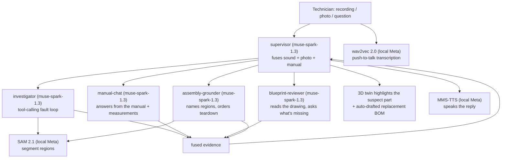
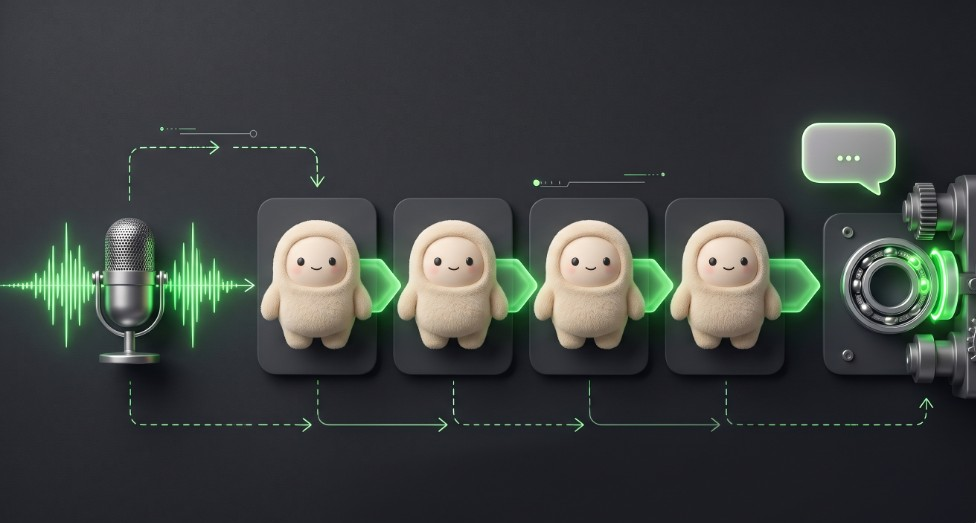
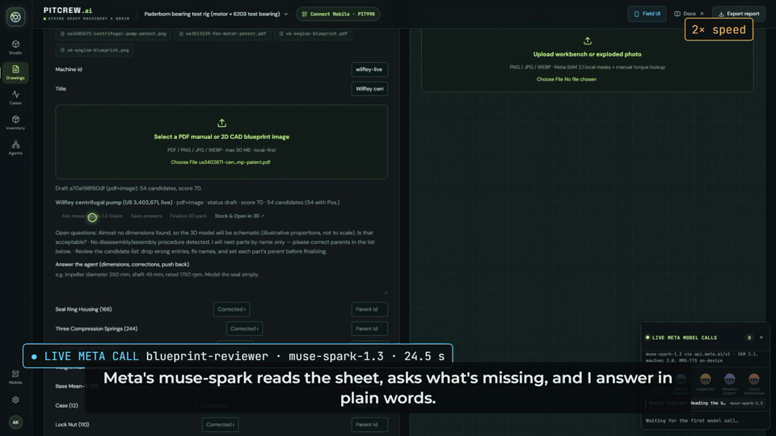
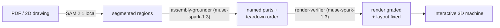
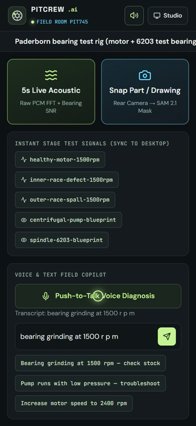

# 

Autonomous machine diagnostics, parametric 3D digital twins, and acoustic fault investigation for industrial equipment. The technician supplies a vibration or microphone recording; the multi-agent mesh consults technical documentation via RAG, runs numerical and acoustic analyses, explains the evidence, and highlights the suspected component in an interactive 3D assembly while auto-drafting the replacement BOM.



*One screen: the 3D twin on the left, the six-agent crew dock on the right, and every `muse-spark-1.3` call streaming live underneath as the agents coordinate.*

Research question: can an agent that selects its own analyses produce a
better-supported investigation than a fixed workflow? See `evals/` for the
three-arm comparison protocol.

## Layout

- `backend/` — FastAPI app: recordings, numerical analyses, agent loop, reports.
- `frontend/` — Vite + TypeScript UI (assembly, evidence plots, investigation steps).
- `scripts/` — smoke tests, data acquisition, evaluation runners.
- `tests/` — automated tests (numerical, API, leakage, replay).
- `docs-pack/` — cited setup/geometry excerpts (label-free) + attribution.
- `evals/` — frozen splits, protocol, and results.
- `data/` — local recordings and reports (NOT committed; see below).
- `skills/anatomy/` — Anatomy drawing kit (MIT, pinned at upstream
  `1482e84`, 2026-10-18): deterministic isometric SVG figures for docs/demo.
  Installed via `git clone` (the `npx skills` CLI is unusable here: broken
  root-owned npm cache); nested `.git` removed so the files commit with the
  repo. To update, re-clone and re-pin. See `visual-plan/reviews/` verdict.

## Setup (about 10 minutes)

Requires Python 3.12 and Node 20 or newer. No GPU: SAM 2.1, wav2vec 2.0 and
MMS-TTS run on the CPU.

1. Create a `.env` file in the repo root with your Meta API key (it is
   gitignored and only read by the server):

   ```
   MODEL_API_KEY=your-key-here
   ```

2. Install and build.

   Windows (PowerShell):

   ```powershell
   py -3.12 -m venv .venv
   .\.venv\Scripts\python.exe -m pip install -r requirements.txt
   cd frontend; npx -y pnpm@10.34.3 install; npx -y pnpm@10.34.3 run build; cd ..
   .\.venv\Scripts\python.exe -m uvicorn backend.app.main:app --host 127.0.0.1 --port 8000
   ```

   macOS / Linux:

   ```bash
   python3.12 -m venv .venv
   .venv/bin/pip install -r requirements.txt
   (cd frontend && npx -y pnpm@10.34.3 install && npx -y pnpm@10.34.3 run build)
   .venv/bin/uvicorn backend.app.main:app --host 127.0.0.1 --port 8000
   ```

3. Open <http://127.0.0.1:8000/?calls=1#workspace>. The `calls=1` panel lists
   every Meta model call as it happens.

The first SAM 2.1 call downloads its 156 MB checkpoint to `data/models/`, and
the first voice call downloads wav2vec 2.0 and MMS-TTS from Hugging Face.
Expect those first calls to be slow.

Without a key, the app still runs: analysis, 3D and inventory work. Calls
to muse-spark-1.3 return a clear "MODEL_API_KEY is not set" message.

## The crew: six Meta agents in harmony



PitCrew is not one prompt. It is a crew of specialist agents that are all **the
same Meta `muse-spark-1.3` model** given a different role, system prompt, and
toolset — plus three local Meta models (SAM 2.1, wav2vec 2.0, MMS-TTS) that do
the perception and voice. The coordination layer is ours:

- **`role()` in [`backend/app/meta_calls.py`](backend/app/meta_calls.py)** wraps
  every `responses.create`, so each call is tagged with the crew role that made
  it and streamed live to `GET /api/meta/calls`. That is what lights up the crew
  avatars in the dock above.
- **The bounded investigator loop in [`backend/app/agent.py`](backend/app/agent.py)**
  (`run()`) lets the investigator agent pick its own analyses turn by turn, under
  application-enforced caps (max tool calls, wall-clock timeout, serialized
  turns). The trace is the deliverable and replays with no new model calls.
- **The supervisor in [`backend/app/assist.py`](backend/app/assist.py)** fuses
  the specialists' findings — sound + photo + manual — into one answer.

So the "harmony" is real orchestration, not a single API call: a supervisor
fans work out to specialists, each specialist calls Meta models with its own
tools, and every call is observable in real time.



### The harness improves itself

The crew gets better without retraining the frozen model. The self-evolving
`Harness^2` harness ([`backend/app/harness.py`](backend/app/harness.py))
separates the frozen `muse-spark-1.3` from the editable execution harness
around it:

- **Propose-Probe-Compose** (`probe_bands`): instead of a fixed analysis, the
  investigator proposes candidate demodulation bands, probes each for
  reference-free BPFO/BPFI harmonic SNR, and composes the diagnostic signal —
  the agent chooses its own analyses turn by turn.
- **Experience Distillation** (`distill_lesson`): when an investigation
  mismatches the revealed fault or a technician corrects it, the harness
  contrasts the trace against the outcome and writes a reusable, auditable
  **skill** into that machine's persistent library. Next time, the agent reads
  those learned skills first. You can see and toggle them in the Agent lab.

The frozen V1 benchmark path (`agent.run(..., mode="v1")`) never touches the
self-evolving harness, so `evals/results.jsonl` stays reproducible — the
three-arm comparison in `evals/` is exactly what measures whether the
self-improving harness beats the fixed workflow.

### Voice is Meta models too

Understanding the engineer's voice and speaking back both run on Meta's own
open-weights speech models, on-device (CPU, no key):

- **wav2vec 2.0** (`facebook/wav2vec2-base-960h`) understands the voice —
  push-to-talk speech-to-text.
- **MMS-TTS** (`facebook/mms-tts-eng`) speaks the reply.

Both are wrapped in the same live call log as the API calls, so a voice
diagnosis shows its Meta speech calls alongside the muse-spark reasoning calls.



Every call appears live in the call log (`?calls=1`), labelled with the crew
role that made it.

| Role | Model | What it does | Code |
| --- | --- | --- | --- |
| blueprint-reviewer | muse-spark-1.3 | Reads a PDF or drawing, places each numbered part, asks what's missing | `backend/app/packbuilder.py` |
| render-verifier | muse-spark-1.3 | Compares the drawing with the 3D render, fixes the layout, writes render skills | `backend/app/render_verify.py` |
| sam-segmenter | SAM 2.1 (local) | Segments drawings and workbench photos into regions | `backend/app/segment.py` |
| assembly-grounder | muse-spark-1.3 | Names SAM regions and orders the teardown steps | `backend/app/segment.py` |
| manual-chat, supervisor | muse-spark-1.3 | Answers from the manual and the measurements, fuses sound + photo + manual | `backend/app/assist.py` |
| investigator | muse-spark-1.3 | Runs the tool-calling fault investigation | `backend/app/agent.py` |
| speech-to-text | wav2vec 2.0 (local) | Push-to-talk transcription | `backend/app/speech.py` |
| voice | MMS-TTS (local) | Speaks replies | `backend/app/speech.py` |

Demo video credits and the call ids behind each sped-up span:
`submission/youtube.md`, `submission/video/CREDITS.md`.

## How a diagnosis flows



**Blueprint to 3D twin.** Upload a PDF manual or a 2D drawing and the
blueprint-reviewer agent reads the sheet, places each numbered part, and asks
what's missing — every question is a live Meta call you can watch.



The full drawing-to-machine path chains two muse calls around local SAM 2.1:



**On the floor, the engineer just talks.** The mobile copilot transcribes
push-to-talk with wav2vec 2.0 and speaks replies with MMS-TTS — both local Meta
models, no key needed for voice.



## Judge path (2 minutes)

1. **3D Twin**: pick *Wilfley centrifugal pump (US 3,402,671)*. It was built
   from a 1968 public-domain patent drawing. Try Assemble, Parts sheet,
   Isolate, Run and Explode. **Compare drawing** overlays the source sheet;
   **Verify again** has SAM 2.1 segment the drawing and muse-spark-1.3 grade the
   render and fix it.
2. **Agent lab**: render skills muse-spark-1.3 wrote during those checks. They
   apply to every machine and can be switched off.
3. **Blueprints**: upload any PDF or drawing image, or use
   `data/demo_assets/blueprints/`. The review asks questions, you answer, then
   Finalize builds a new 3D machine.
4. **Diagnose**: play a bundled recording (healthy, inner-race,
   outer-race). The crew avatars light up as each Meta call runs.

Results on drawings the pipeline had never seen: `evals/blueprint-to-3d.md`.

Tests (no network, no key needed):
`.venv/bin/python -m pytest tests/ -q` (Windows: `.\.venv\Scripts\python.exe -m pytest tests/ -q`).

## Data

Everything the demo needs is in `data/demo_assets/` (synthetic signals, bundled
blueprints, and three public-domain patents; see `data/README.md`).

Optional measured recordings come from the Paderborn Bearing DataCenter (CC BY-NC 4.0).
Raw recordings stay outside the repository. Acquisition:

```bash
source .venv/bin/activate
python scripts/fetch_sample.py --bearing K001 --out data/recordings
```

See `data/README.md` for the full acquisition + attribution instructions.

Data-use gate: confirm CC BY-NC 4.0 compatibility with the accepted competition
terms before submission use. Attribution and acquisition instructions do not
themselves resolve permission for competition use.

## Smoke test (Meta API)

```bash
.venv/bin/python scripts/smoke_meta.py   # Windows: .\.venv\Scripts\python.exe scripts\smoke_meta.py
```

Performs one real Responses API tool round-trip on `muse-spark-1.3` (Standard
mode) and logs model ID, latency, and token usage. Must pass before any agent
work (Day-1 gate).

The server binds to localhost only.

## Stack

Python 3.12, NumPy/SciPy, FastAPI, Vite + TypeScript, Three.js, Plotly.js.
Meta `muse-spark-1.3` via the Responses API (OpenAI-compatible SDK), with local
Meta SAM 2.1, wav2vec 2.0, and MMS-TTS.

The Meta-developed layer is the coordination, not just the API call: the bounded
investigator loop ([`backend/app/agent.py`](backend/app/agent.py)), the
`role()`-tagged live call log ([`backend/app/meta_calls.py`](backend/app/meta_calls.py)),
and the supervisor that fuses sound + photo + manual
([`backend/app/assist.py`](backend/app/assist.py)) are what turn six muse-spark
agents into one crew.
